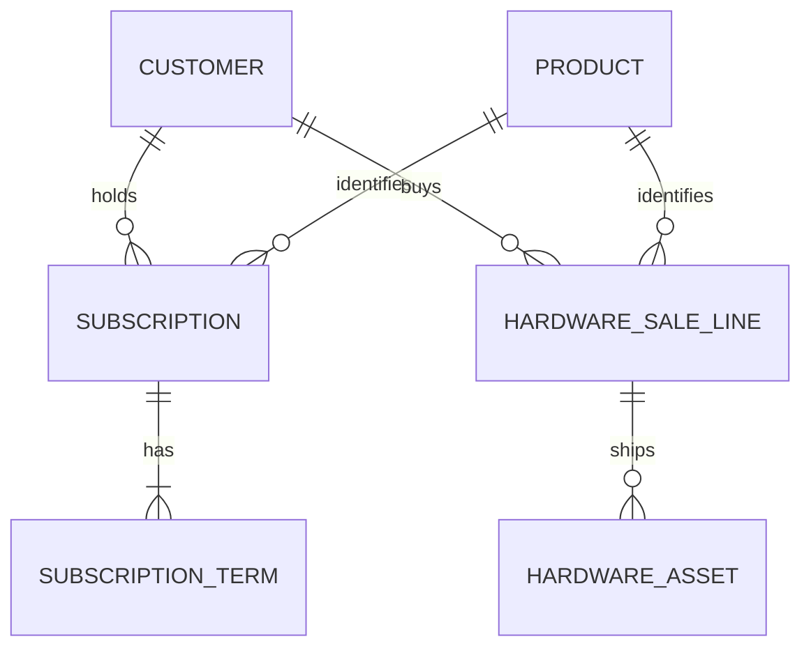

# Customer Product and Subscription Mapping

A fictional technology reseller needs one customer-to-product view for account managers and finance. The view connects software seats, annual subscriptions, and renewal terms to customers. It also shows one-time hardware purchases and tracks serialized units through shipment.

All customers, products, identifiers, prices, and costs are synthetic.

| Output | Grain | Answers |
| --- | --- | --- |
| Customer product mapping | Customer × SKU | Which products does the customer have, with what seats, units, prices, and costs? |
| Active software and renewal pipeline | Subscription term | What is active, what is coming due, and what successor has been signed? |
| Hardware orders and serials | Sale line and shipped asset, respectively | What was booked, what shipped, and which serials went to this customer? |
| Customer summary | Customer | What are the recurring annual software amounts and the separate period hardware amounts? |

**Price** is what the customer pays under the agreement or sale. **Cost** is the reseller’s direct unit cost. **Margin** is the difference. Software amounts are annual contracted values at the snapshot date. Hardware amounts are one-time booked values for the selected sales period. All monetary fields use USD cents in SQL.

## Run in Snowflake

Use an empty scratch schema and an active warehouse. Run [schema](sql/01_schema.sql), [synthetic fixtures](sql/02_seed.sql), and [model](sql/03_model.sql) in order. Confirm that every [release control](sql/04_controls.sql) returns zero rows, then run the [reports](sql/05_reporting.sql).

### Expected results at the June 30, 2025 cutoff

Hardware sales period is January 1 through June 30, inclusive. Amounts below are in USD.

| Customer | Active seats | Annual software sales | Annual software cost | Booked hardware sales | Booked hardware cost |
| --- | ---: | ---: | ---: | ---: | ---: |
| Northstar Clinic | 70 | $10,800 | $6,500 | $7,700 | $5,100 |
| Harbor Fabrication | 25 | $3,500 | $2,000 | $3,200 | $1,900 |
| Beacon Studio | 0 | $0 | $0 | $0 | $0 |

- **Renewal economics.** Northstar's signed endpoint renewal adds 10 seats and increases annual sales by $600. Direct annual costs rise by $1,000, so annual margin falls by $400. The new terms become active July 1.
- **Pipeline visibility.** Harbor's August renewal is still unsigned at the June cutoff. Its successor is signed July 10, so it remains absent from the June renewal amounts.
- **Hardware fulfillment.** Northstar booked three edge appliances. Two serials had shipped by the cutoff and the third ships July 3. The order line carries the full booked economics once.

See the [architecture decisions](docs/architecture.md) and [operations runbook](docs/runbook.md) for the scope, controls, and failure exercises.
